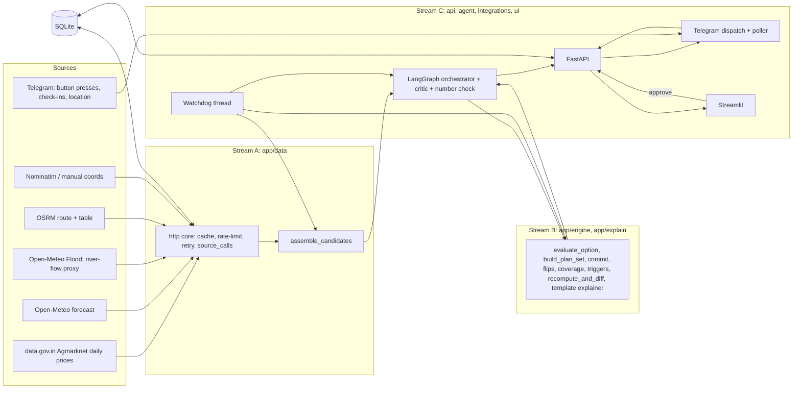

# PLAN.md — MandiGuard: Technical Plan (stack, rules, data, formulas, schedule)

Status legend used throughout: **VERIFIED** (read in a primary source or tested) · **ASSUMPTION** (our choice, must be shown in UI) · **UNKNOWN** (not verified — test at gate A1).

---

## 1. Product definition (one screen)

**User:** FPO dispatcher / trader. **Decision:** where, when and by which route to send a tomato load, *and what to do if conditions change after dispatch.*

**Inputs:** origin (lat/lon + label + state), quantity (quintals), ripeness stage (MG/Breaker/Turning/Pink), vehicle (open/covered/refrigerated + set-point), loading time, preferred departure, transport cost basis, deductions (if known), per-mandi latest-arrival time (if known), risk mode, ripening limit.

**Outputs:** `PlanSet` = Plan A (best risk-adjusted), Plan B (best where A fails), Plan C (hold/later departure) — each with net value range, travel time, rain exposure, window status, ripening exposure range, flip boundaries, commitment points, "reconsider if…" conditions — plus an evidence-coverage grade and robustness count. After approval: Telegram dispatch → monitoring → trigger → recompute → structured diff → human approval.

---

## 2. Locked decisions

| ID | Decision | Rationale |
|---|---|---|
| D-01 | MVP crop = tomato only | Only crop with verified stage×temperature ripening data |
| D-02 | Price scenarios = low/typical/high **observed in today's record** (min/modal/max), labelled "reported today" | Only live price info; NOT a forecast |
| D-03 | Money scenarios = 3 price × 3 delay = **9**. Cargo-temperature offsets are a **separate ripening check** (offsets don't change money → would duplicate scenarios) | Logic test showed 27 raw → 9 distinct |
| D-04 | Plan A score = mean of the **k = ceil(0.25·n)** lowest net values (n=9 → k=3) | Deterministic CVaR-style; `risk_mode="mean"` optional |
| D-05 | Ripening interpolation on **rate (1/days)**, linear in temperature within 12.5–25 °C; outside → `None` + flag | ≤ 4 % difference vs day-interpolation across table midpoints (tested) |
| D-06 | Price-change ML is **not** in MVP; P1 only if it beats persistence on a temporal split | Persistence is a hard baseline; live feed has no lag history |
| D-07 | Single LangGraph orchestrator; deterministic engine; LLM optional (template explainer always available) | Robustness; no hallucinated numbers |
| D-08 | Telegram via raw Bot API with **long-polling thread** (no webhook / public URL) | Simple, works behind laptop NAT |
| D-09 | Monitoring input = Telegram check-in buttons (reliable) + optional live location (only if A1 proves it) + manual ETA-slip control (labelled) + route-estimate fallback | Live location is UNKNOWN until tested |
| D-10 | Mandi closing times are **user-configured** (no verified source). Unknown ⇒ window = "unknown", no commit points, coverage downgrade | NN-10 |
| D-11 | Delay stress multipliers are **ASSUMPTIONS** (adjustable, shown in UI) | No India-specific verified source |
| D-12 | Commitment points are **approximate** (≤ 8 sampled waypoints) and **scenario-dependent**; label "last feasible diversion waypoint under <scenario>" | Honest about OSRM/waypoint limits |
| D-13 | Flip scan applies delay to the **monitored plan (A)** only; B evaluated at its own nominal. | A bug in the first logic test applied delay to both → meaningless flip at 0 |
| D-14 | SQLite single file; background tasks = threads inside the FastAPI process | 36-hour practicality |

---

## 3. Tech stack (only these; ask before adding)

| Layer | Choice | Notes |
|---|---|---|
| Language | Python 3.11+ | |
| API | **FastAPI + Uvicorn**, pydantic v2, sync endpoints | OpenAPI docs at `/docs` for free demo/testing |
| HTTP client | `requests` (sync) | same as `scripts/check_apis.py` |
| DB / cache | SQLite (stdlib `sqlite3`) | evidence, caches, plans, traces |
| Agent | `langgraph` + SQLite checkpointer | Justified by `interrupt`/resume for approvals + trace. **Fallback:** same node functions in a plain Python state machine if LangGraph integration costs > 4 h |
| LLM (optional) | Groq (OpenAI-compatible) primary, Anthropic fallback; raw `requests` | Intake parsing, tool choice, diff paraphrase only |
| Telegram | raw Bot API via `requests`, background long-poll thread | |
| UI | **Streamlit** (calls FastAPI over HTTP), `pydeck` map | |
| Tests | `pytest`, `responses` (HTTP mocks, tests only) | |
| Config | `.env` + `app/config.py` | |

Install policy: after the first clean install run `pip freeze > requirements.lock`. Verify package names/versions at install time (do not trust memory).

---

## 4. Architecture



**Data-flow rule:** Stream A returns `CandidateAssembly` (contract types + `Evidence`). Stream B consumes `CandidateInputs`, returns `PlanSet`/`PlanDiff`/`CoverageReport` (pure). Stream C orchestrates, persists, serves, notifies, renders.

---

## 5. Data sources & verification status (gate A1 fills the real result)

| # | Purpose | Primary | Key? | Fallback(s) | Status (from research) |
|---|---|---|---|---|---|
| 1 | Daily mandi prices | `https://api.data.gov.in/resource/9ef84268-d588-465a-a308-a864a43d0070` | Free key (register → My Account) | CEDA Agmarknet / India Data Portal (**historical only, not live**); agmarknet.gov.in & e-NAM pages (no verified API) | Fields VERIFIED in docs: state, district, market, commodity, variety, grade, arrival_date, min/max/modal price. **No arrivals field.** Uptime **UNKNOWN** (one project reported it down all hackathon; a wrapper README says frequently blocked) → **TEST FIRST** |
| 2 | Forecast weather | `https://api.open-meteo.com/v1/forecast` | No | MET Norway `api.met.no` (UNVERIFIED) | Docs VERIFIED: free non-commercial, < 10k calls/day, 5k/h, 600/min, CC BY 4.0, hourly, up to 16 days |
| 3 | Past weather | `https://archive-api.open-meteo.com/v1/archive` | No | — | VERIFIED in docs |
| 4 | Past forecasts (backtest) | `https://historical-forecast-api.open-meteo.com/v1/forecast` | No | — | Product VERIFIED (from 2021); host from memory → test |
| 5 | River-flow proxy | `https://flood-api.open-meteo.com/v1/flood` | No | — | GloFAS v4, ~5 km, discharge of largest river within the cell; **proxy only** |
| 6 | Routing | `https://router.project-osrm.org` (route, table) | No | `routing.openstreetmap.de/routed-car` (from memory), OpenRouteService (key), self-hosted OSRM | Demo server VERIFIED: non-commercial, ≤ 1 req/s, no uptime guarantee |
| 7 | Geocoding | `https://nominatim.openstreetmap.org/search` | No (User-Agent required) | Open-Meteo geocoding, Photon, **manual `mandi_coords.csv`** | Policy VERIFIED: ≤ 1 req/s, UA required, cache, no bulk, attribution |
| 8 | Dispatch/approval | Telegram Bot API | Bot token | in-app approval | Button callbacks + location messages exist; **live-location edits UNKNOWN until tested** |
| 9 | LLM (optional) | Groq `api.groq.com/openai/v1` | Key | Anthropic API | endpoints from memory → test |

`scripts/check_apis.py` (already written) tests all of the above. Results go into `PROGRESS.md → API Verification`.

**Decision rule at G1 (hour ≈ 3):**
- Mandi API PASS (fresh record ≤ 3 days, 10 fields) → proceed as planned.
- Mandi API FAIL → choose: (a) second verified live source (only if A verifies it), (b) **replay-led + abstain-first** demo with banners, (c) pivot. Human decides; log in Decisions.
- Telegram live location FAIL → check-in buttons + manual ETA slip (already the primary).

---

## 6. ASSUMPTIONS REGISTRY (all live in `app/config.py`; all shown in the UI "Assumptions" panel)

| Key | Default | Status | Meaning |
|---|---|---|---|
| `DELAY_MULT` | none 0.0 · moderate 0.25 · severe 0.60 | ASSUMPTION | stress multipliers on nominal duration |
| `CVAR_Q` | 0.25 | design | k = ceil(q·n) |
| `EPS_ABS_RS`, `EPS_REL` | 500, 0.03 | ASSUMPTION | regret threshold defining A's failure |
| `NEXT_DAY_WAIT_H` | 12 | ASSUMPTION | hours of holding if window missed (user-editable) |
| `OFFSETS_C` | open [0,5,10] · covered [0,3,6] · refrigerated [0] | ASSUMPTION | cargo temp − ambient. Evidence: one study reports exposed fruit 10–15 °C above ambient (non-Indian) |
| `RIPENING_LIMIT_PCT` | 25 | user threshold | NOT evidence-based |
| `HANDBOOK_ALERT` | transport > 12 h with cargo > 25 °C | guidance from one handbook | alert text only |
| `PRICE_DEGRADE_DAYS`, `PRICE_ABSTAIN_DAYS` | 3, 7 | ASSUMPTION | record-age thresholds |
| `CANDIDATE_K` | 8 | design | straight-line prefilter → top K mandis routed |
| `WAYPOINT_SPACING_KM`, `MAX_WAYPOINTS` | 25, 8 | design | route sampling |
| `DEPARTURE_SLOTS_H` | +2, +4, +8, +12 (bounded by forecast horizon) | design | Plan C candidates |
| `POLL_INTERVAL_S` | 300 (demo 30) | design | watchdog tick |
| `HYSTERESIS_N` | 2 consecutive ticks | design | trigger persistence |
| `REPLAN_MARGIN_ABS_RS`, `REPLAN_MARGIN_REL` | 1000, 0.02 | ASSUMPTION | min improvement to propose a change |
| `COOLDOWN_MIN` | 30 | design | after a replan proposal |
| `WINDOW_MISS_TRIGGER` | ≥ 3 of 9 scenarios | design | |
| `CACHE_TTL` | mandi 60 min · weather 30 min · routes 24 h · geocode ∞ | design | |
| `RATE_LIMIT` | OSRM 1/s · Nominatim 1/s | policy | |

---

## 7. NORMATIVE FORMULAS & RULES (Stream B implements exactly; Streams A/C must not reimplement)

### 7.1 Units & net value
```
Q  = quantity_qtl (quintals);  P ∈ {low, typical, high} in ₹/qtl (from ONE record)
gross       = Q × P
pct         = (commission_pct + market_fee_pct + other_pct)/100      # unknown parts treated as 0 AND flagged deductions_known=False
fixed_ded   = Q × (hamali_per_qtl + loading_per_qtl)                  # unknown → 0 + flagged
transport   = per_km_per_trip: rate × distance_km
              fixed_per_trip : rate
              per_qtl_per_km : rate × Q × distance_km                # distance_km is one-way as returned by OSRM
hold        = hold_cost_per_hour × wait_hours                         # wait_hours = NEXT_DAY_WAIT_H if window missed else 0 (+ Plan C wait)
Net         = gross × (1 − pct) − fixed_ded − transport − hold
```
Golden: Q=40, P=1500, pct=6 %, fixed 10/qtl, transport 4800 ⇒ Net = 51 200 (`40*1500*0.94 − 400 − 4800`). Passing kg instead of qtl must be impossible (validated schema).

### 7.2 Window feasibility
`arrival = depart + duration_nominal × (1 + δ_s)`. If `latest_arrival_local` known: `met` if arrival (Asia/Kolkata) ≤ that time on the arrival date, else `missed` (⇒ `NEXT_DAY_WAIT_H` holding, same price level, **no price drift modelled**, ripening continues at destination ambient). Unknown ⇒ `unknown` (no penalty, coverage downgrade, commit points not computed).

### 7.3 Scenario grid (9) and scoring
`price_level ∈ {low,typical,high}` × `delay_level ∈ {none,moderate,severe}`. For each option compute `Net(s)`. `score = mean(k lowest Net)` with `k = ceil(0.25·9) = 3` (or `mean` if risk_mode=mean). Deterministic tie-break: higher mean → shorter nominal duration → `option_id` ascending.

### 7.4 Plan A / B / C
- **Candidate options** = (mandi × route option × departure = preferred_departure). Options with `ripening.flag != ok` or `price is None` are excluded from A unless none qualify (then A is chosen and flagged; if no priced option → ABSTAIN).
- **A** = argmax score over eligible options.
- **Fail(A)** = scenarios s where A's window is `missed` **or** `regret_A(s) = max_p Net(p,s) − Net(A,s) > max(EPS_ABS_RS, EPS_REL·|Net(A,s)|)`.
- **B** = argmax over options p ≠ A (reachable from the current waypoint if already dispatched) of `mean_{s ∈ Fail(A)} Net(p,s)`. If Fail(A) is empty: B = best remaining by score and `role_note = "A is robust in all tested scenarios; B is the standby"`. B ≠ "second best overall" unless that is what the rule returns.
- **C** = best over `DEPARTURE_SLOTS_H` (using the forecast for that slot) of the same score, net of `hold_cost_per_hour × wait` and with ripening consumed during the wait at ambient staging temperature (**ASSUMPTION**, labelled). Always shown; `role_note` states whether C beats A on score.
- **robustness** = number of the 9 money scenarios in which A has the highest Net among eligible options ("A is best in k of 9 tested scenarios").

### 7.5 Commitment points (approximate)
For monitored plan A on route r and alternative B (mandi m_b), for waypoint i and scenario s with δ_s:
`eta_B(i,s) = depart + (elapsed_i + to_dest_i[m_b]) × (1+δ_s)`; feasible iff `latest_arrival_B` known and `eta_B ≤ latest_arrival_B`.
`last_feasible_waypoint[s] = max{ i : feasible(i,s) }` (or `None`). Report per scenario; label "approximate (≤ 8 sampled waypoints; assumes the driver can divert at that waypoint)". Never print "point of no return" without that label. If B's closing time is unknown: `computed=False`.

### 7.6 Flip boundaries
- **Delay flip:** scan δ from 0 to 1.0 in steps of 0.05 (typical price). `delay_flip_pct` = smallest δ (× 100) where `Net_B_nominal > Net_A(δ)` (delay applied to A only, D-13); else `None` ("no flip within tested range"). Also return `diversion_feasible_at_flip` using 7.5 at that δ.
- **Price flip:** with A's window state fixed, `P_A* = (Net_B + transport_A + fixed_ded_A + hold_A) / (Q × (1 − pct))` — typical price at A below which B wins.
- **Reconsider-if conditions** are generated from these (ETA slip ≥ δ_flip × duration; A's typical price ≤ P_A*; ripening ≥ limit; window-miss scenarios ≥ trigger; remaining-route rain beyond threshold). Numbers are never produced by an LLM.

### 7.7 Tomato ripening exposure
Reference table (UC Davis, days to full red; **VERIFIED** table; conventional cultivars; measures ripening, not spoilage):

| Stage | 12.5 | 15 | 17.5 | 20 | 22.5 | 25 °C |
|---|---|---|---|---|---|---|
| MG | 18 | 15 | 12 | 10 | 8 | 7 |
| BREAKER | 16 | 13 | 10 | 8 | 6 | 5 |
| TURNING | 13 | 10 | 8 | 6 | 4 | 3 |
| PINK | 10 | 8 | 6 | 4 | 3 | 2 |

`consumed = Σ_segments (hours_i/24) / D(stage, T_ambient_i + offset)`, `D` by rate interpolation. Any segment outside [12.5, 25] ⇒ `consumed_pct=None`, `out_of_range=True` (no extrapolation). Flags: `out_of_range` > `chilling_risk` (refrigerated set-point < 12.5 °C with MG) > `over_limit` (worst consumed > user limit) > `ok`.
Golden: PINK, 10 h at 20 °C ⇒ 10.4 %; at 22 °C ⇒ 13.2 %; at 25 °C ⇒ 20.8 %; at 26 °C ⇒ None/out_of_range.
UI may claim: "share of the remaining ripening window consumed during transit (range across assumed cargo offsets)". UI may NOT claim spoilage, shelf-life days, grade loss or ₹ loss.

### 7.8 Evidence coverage grade (rules, no percentages)
- **ABSTAIN** if: no priced candidate, or newest price record older than `PRICE_ABSTAIN_DAYS`, or no usable route for any candidate.
- Count caveats among: price older than `PRICE_DEGRADE_DAYS`, weather incomplete on route, closing time unknown, deductions unknown, ripening out of range/over limit, location precision = district centroid, unit unverified.
- 0 caveats ⇒ `ACTIONABLE`; 1–2 ⇒ `ACTIONABLE_WITH_CAVEATS`; ≥ 3 ⇒ `ADVISORY_ONLY`. Each item in the report lists dimension, kind tag, status, detail.

### 7.9 Triggers, hysteresis, recompute (post-dispatch)
Triggers evaluated each tick: **T1** ETA slip ≥ δ_flip (or user bound); **T2** window-miss scenarios ≥ `WINDOW_MISS_TRIGGER` (or A missed at nominal); **T3** remaining-route rain exposure increased beyond threshold vs plan time; **T4** ripening worst-case ≥ limit; **T5** new daily price record moved ≥ price-flip boundary (fires at most once per new record); **T6** river-flow proxy percentile alert — **advisory only, never auto-recompute**.
A trigger must hold for `HYSTERESIS_N` consecutive ticks. Then recompute from **fresh** data; propose a change only if `Net/score(best alt) − Net/score(current) ≥ max(REPLAN_MARGIN_ABS, REPLAN_MARGIN_REL·|current|)`; otherwise log "trigger fired, no better option — continue" (a valid outcome). Cooldown `COOLDOWN_MIN`. Output = new `PlanSet(version+1)` + `PlanDiff` (deterministic: which term changed, old→new, effect). Human approval required to adopt.

---

## 8. Database (SQLite) — owned by Stream A (`app/db/schema.sql`)

```sql
CREATE TABLE source_calls(id INTEGER PRIMARY KEY, ts TEXT, source TEXT, url_redacted TEXT, http INT, latency_ms INT, ok INT, note TEXT);
CREATE TABLE evidence(id TEXT PRIMARY KEY, kind TEXT, label TEXT, value TEXT, unit TEXT, source TEXT, as_of TEXT, fetched_at TEXT, stale INT, note TEXT);
CREATE TABLE price_records(id INTEGER PRIMARY KEY, fetched_at TEXT, state TEXT, district TEXT, market TEXT, commodity TEXT, variety TEXT, grade TEXT, arrival_date TEXT, min_price REAL, max_price REAL, modal_price REAL, unit TEXT, unit_verified INT, raw_json TEXT);
CREATE TABLE geocode_cache(key TEXT PRIMARY KEY, lat REAL, lon REAL, precision TEXT, display_name TEXT, source TEXT, fetched_at TEXT);
CREATE TABLE route_cache(key TEXT PRIMARY KEY, json TEXT, fetched_at TEXT);
CREATE TABLE weather_cache(key TEXT PRIMARY KEY, json TEXT, fetched_at TEXT);
CREATE TABLE mandi_settings(mandi_id TEXT PRIMARY KEY, name TEXT, latest_arrival_local TEXT, lat REAL, lon REAL, precision TEXT, source TEXT); -- user-filled; empty at start
CREATE TABLE plans(plan_id TEXT PRIMARY KEY, request_json TEXT, status TEXT, created_at TEXT, updated_at TEXT);
  -- status: draft|awaiting_approval|dispatched|monitoring|replan_pending|completed|abstained|rejected
CREATE TABLE plan_versions(plan_id TEXT, version INT, planset_json TEXT, diff_json TEXT, created_at TEXT, PRIMARY KEY(plan_id, version));
CREATE TABLE approvals(id INTEGER PRIMARY KEY, plan_id TEXT, version INT, kind TEXT, decision TEXT, by TEXT, ts TEXT); -- kind: dispatch|replan
CREATE TABLE actions(id INTEGER PRIMARY KEY, plan_id TEXT, type TEXT, payload_json TEXT, receipt_json TEXT, ok INT, ts TEXT);
CREATE TABLE watch_state(plan_id TEXT PRIMARY KEY, last_tick_ts TEXT, trigger_counts_json TEXT, cooldown_until TEXT, last_progress_json TEXT);
CREATE TABLE watch_events(id INTEGER PRIMARY KEY, plan_id TEXT, ts TEXT, kind TEXT, detail_json TEXT);
CREATE TABLE agent_trace(id INTEGER PRIMARY KEY, plan_id TEXT, step INT, node TEXT, tool TEXT, args_json TEXT, result_summary TEXT, ok INT, ts TEXT);
CREATE TABLE replay_runs(id INTEGER PRIMARY KEY, name TEXT, params_json TEXT, result_json TEXT, created_at TEXT); -- P1
```

---

## 9. FastAPI endpoints (Stream C; models from `app/contracts/`)

| Method | Route | Request → Response |
|---|---|---|
| GET | `/health` | → `{status, mode, time}` |
| GET | `/sources/health` | → `list[SourceStatus]` |
| GET | `/assumptions` | → current config registry |
| POST | `/plan` | `DispatchRequest` → `{plan_id, status, planset|None, coverage, trace_id}` (runs A→B pipeline; ABSTAIN returned as a normal result) |
| GET | `/plans/{id}` | → request, latest `PlanSet`, status, versions |
| GET | `/plans/{id}/trace` | → agent trace + evidence refs |
| GET | `/evidence/{id}` | → `Evidence` |
| POST | `/plans/{id}/approve` | `{version, decision: approve|reject, kind: dispatch|replan}` → action receipt (Telegram message id) |
| POST | `/plans/{id}/progress` | `DispatchProgress` (check-in / manual ETA / location) → ack |
| POST | `/plans/{id}/watch/tick` | → `{triggers, decision, new_version?, diff?}` (manual tick for demo; same code as watchdog) |
| POST | `/plans/{id}/whatif` | `{delay_min?, rain_mm_segment?, price_delta_pct?}` → recomputed PlanSet **marked `what_if`** (never persisted as observed) |
| GET | `/plans/{id}/diff?from=&to=` | → `PlanDiff` |
| GET | `/flip-finder` | P1 |
| POST | `/replay` | P1 (labelled historical) |

---

## 10. Agent design (Stream C; engine from Stream B)

Single graph, state = `{request, assembly, planset, coverage, trace[], approval, progress, triggers, diff}`.
Nodes: `intake → source_gate → plan(tool choice) → tools → critic → decide(engine) → coverage → explain(template, LLM optional) → number_check → approval(interrupt) → dispatch → watch → trigger_eval → recompute → diff → approval`.
- **Tool registry (typed):** `get_mandi_records`, `geocode`, `get_routes`, `get_route_table`, `get_weather_along`, `refresh_source`, `widen_candidates`, `request_alt_routes`. The LLM (if enabled) chooses next tool by name from this list; arguments validated against schemas; max 12 steps; loop guard.
- **Critic (deterministic):** stale/missing/implausible checks (price ≤ 0, min>modal, duration absurd, null weather). May route back to `plan` ≤ 2 times, else degrade coverage.
- **Number check:** every number in explanation text must match a ledger/engine value within rounding; else fall back to template.
- **LLM-off mode** must give a full, correct demo.

---

## 11. Demo modes & script

`MG_MODE=live` for judges. Banners per NN-2. Script (≈ 6 min): (1) source-health strip with record dates & kind tags → (2) enter tomato load → (3) A/B/C cards with coverage grade → (4) "why not the highest-price mandi?" (its failing scenarios) → (5) change departure slot / apply labelled what-if → plans change or flip boundary moves → (6) approve → Telegram message with buttons on a judge's phone → (7) check-in "Delayed +1h" (or live location if verified) → watchdog tick → (8) trigger persists → recompute → diff screen → approval of Plan B → (9) P1: labelled historical replay + regret vs naive baseline.
**If weather is benign:** what-if overlay (labelled), departure-slot changes, judge-set closing time, replay (labelled), Flip Finder (P1). Never fake an observation.
**If a source fails:** show last real snapshot with age + degraded grade, or ABSTAIN visibly.

---

## 12. Scope matrix

| Feature | Class | Est. h | Failure risk |
|---|---|---|---|
| Mandi ingestion | **P0** | 3 | API down/blocked (HIGH) |
| Weather along route | **P0** | 3 | low |
| Geocoding + coords table | **P0** | 2 | ambiguity (med) |
| Routing + table | **P0** | 3 | demo-server limits (med) |
| Scenario grid, Plan A/B/C | **P0** | 6 | logic bugs (tests guard) |
| Ripening exposure | **P0** | 2 | none (pure) |
| Commitment points, flip boundaries | **P0** | 4 | approximations (labelled) |
| Evidence ledger + coverage grader | **P0** | 3 | low |
| FastAPI + DB | **P0** | 3 | low |
| LangGraph + critic + number check + template explainer | **P0** | 6 | integration (fallback: plain state machine) |
| Telegram dispatch/approval/check-in | **P0** | 3 | token/network |
| Watchdog + hysteresis + recompute + diff | **P0** | 5 | tuning |
| Streamlit UI (4 screens) + what-if | **P0** | 5 | time |
| Deployment + hardening | **P0** | 2 | low |
| Historical replay | P1 | 4 | data volume |
| Backtest vs baselines | P1 | 4 | needs replay |
| Flip Finder | P1 | 2 | rate limits |
| Telegram live location | P1 | 1 | UNKNOWN |
| Price-change quantiles | P1 (only if beats persistence) | 4 | likely no skill |
| Everything in AGENT.md §3 OUT | **REMOVE** | — | — |

---

## 13. Timeline (3 people, 36 h) and gates

| Hours | Stream A | Stream B | Stream C |
|---|---|---|---|
| 0–2 | **A1** API verification gate | B1, B2 (no deps) | **M0** scaffold + contracts (G0) |
| 2–12 | A2 http core → A3 mandi → A4 geocode → A5 routing → A6 weather | B3 net → B4 scenarios → B5 plans → B8 coverage | C1 FastAPI+DB (+stub providers in `dev_stub`) → C2 Telegram |
| **12** | **G2 vertical slice:** `POST /plan` with live data returns `PlanSet` (A7 assembler + B5 + C1) | | |
| 12–24 | A7 assembler/source health → A8 history (P1) | B6 commit → B7 flips → B9 triggers/recompute/diff → B9b explainer | C3 LangGraph → C4 watchdog → C5 Streamlit |
| **24** | **G3 dispatch loop:** approve → Telegram → check-in → tick → recompute → diff → approve | | |
| 24–32 | A: deployment, hardening, caches, replay data | B: P1 backtest; edge cases | C: UI polish, what-if, E2E tests, Flip Finder (P1) |
| **32** | **G4 FREEZE** (no new features) | | |
| 32–36 | rehearsal ×3, failure drills (kill each API), backup demo path | | |

**Gates:** G0 contracts merged (≈ H2) · G1 API verification decision (≈ H3) · G2 vertical slice (H12) · G3 dispatch loop (H24) · G4 freeze (H32) · G5 final rehearsal (H36).
**Kill rules:** no vertical slice by H14 → cut P1 and simplify UI; LangGraph not working by H20 → plain state machine; no live price by H3 → replay-led scope (human decision).

---

## 14. Risks (short)
Mandi API down (HIGH) → A1 gate, abstain/replay · parameters unsupported (delay, offsets) → labelled assumptions + flip boundaries · OSRM throttling → cache/limiter/fallback · geocoding errors → manual coords for ~15 demo mandis · Telegram location UNKNOWN → check-in buttons · benign weather → what-if/replay · scope creep → Vision Lock + Scope Requests · Open-Meteo non-commercial → note in README.

## 15. Questions to ask organisers (record answers in PROGRESS.md)
1. May we use pre-collected historical datasets (CEDA / India Data Portal) and cached API responses? 2. Is a pre-hackathon verified `mandi_coords.csv` allowed? 3. Are labelled historical replays acceptable alongside live demo? 4. Is Telegram permitted as the action channel? 5. Any restrictions on free-tier APIs during judging?
