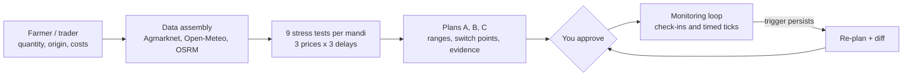
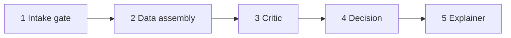

<div align="center">

# 🍅 MandiGuard

### The highest price on the board is not always the right place to send the load.
*सबसे ऊँचा भाव हर बार सही मंडी नहीं होता।*

**Dispatch decision support for Indian farmers and traders.**
Compare mandis on what you actually keep, check the road and the clock, and re-plan while the truck is moving.


[The issue](#-the-issue) · [What we built](#-what-mandiguard-does) · [How it works](#-how-it-works) · [Agents](#-the-agentic-workflow) · [Run it](#-run-it-in-5-minutes)

</div>

---

## 🚨 The issue

Every day, a farmer or trader loads a truck and has to answer one question: **which mandi?**

Most decide with yesterday's price and a few phone calls. But the number on the board is only the start of the story. What reaches the seller depends on:

| What the board shows | What decides your actual income |
|---|---|
| Price per quintal | Transport cost for *this* distance |
| | Commission, market fee and hamali |
| | Delay on the road |
| | Rain along the route |
| | Whether the truck arrives **before the market closes** |

A load that misses the closing window waits a day. A mandi that looked best on paper can leave less in the pocket. And once the truck is on the road, nobody re-checks the plan when conditions change.

**Why it matters:** this decision is made every single day, by people whose income rides on one load. A better-informed choice, and a warning in time to divert, goes straight to their earnings.

### One load, two mandis (illustrative)

| 40 quintals | Mandi P | Mandi Q |
|---|---|---|
| Board price | **Rs 2,100 / qtl** | Rs 1,900 / qtl |
| Value at board price | Rs 84,000 | Rs 76,000 |
| Transport | - Rs 11,000 | - Rs 4,000 |
| Commission, fee, hamali | - Rs 5,800 | - Rs 5,200 |
| Arrives after closing, waits a day | - Rs 3,500 | none |
| **What you keep** | **Rs 63,700** | **Rs 66,800** |

The board said P. The pocket says Q. MandiGuard shows you this *before* the truck leaves.

---

## ✅ What MandiGuard does

Enter the commodity, quantity, origin, departure time and your costs. Get **three compared plans**, each with a range of outcomes instead of a single guess:

| Plan | Role | What you see |
|---|---|---|
| **A** | Primary choice | Net-value range, travel time, rain exposure, market-window status |
| **B** | Backup if A fails | Chosen to hold up when A's conditions break |
| **C** | Leave later | Departure slots compared with the cost of waiting |

Every plan also carries:

- 🔀 **Switch points**: "if delay passes X or price drops by Y, Plan B wins"
- 📍 **Commit points** on the route, where changing course stops being practical
- ❓ **"Why not the highest-price mandi?"** in plain language
- 🧾 **An evidence ledger**: each number links to its source and record date
- 🟢 **A coverage grade** from *Actionable* to *Abstain*, so you always know how well-supported a plan is

After you approve a plan, MandiGuard **keeps watching** and proposes a re-plan, with a clear before-and-after, when something changes.

---

## ⚙️ How it works



**Under the hood**

- **9 stress tests per mandi**: 3 price cases (low, typical, high) x 3 delay cases, so the weaker outcomes count as much as the good ones.
- **Risk-aware scoring**: plans are ranked with a worst-quarter average, not just the average.
- **Market window check**: arrival time against each mandi's closing time.
- **Rain along the route**: weather sampled at points on the road.
- **Hysteresis**: a trigger must persist over several ticks before a re-plan is proposed, so the plan does not flip-flop.

---

## 🤖 The agentic workflow

A **LangGraph** workflow runs five specialised agents. Each one does a single job and records what it did.



| Agent | Job |
|---|---|
| **1. Intake gate** | Validates the request and the system mode |
| **2. Data assembly** | Pulls candidate mandis, prices, routes and route weather |
| **3. Critic** | Checks the data is complete and usable before any decision |
| **4. Decision** | Runs the scenario engine and builds Plans A, B and C |
| **5. Explainer** | Writes a plain-language summary (Hindi or English) and audits every number |

After dispatch, the same graph runs the **monitoring loop**: refresh price and weather, evaluate triggers (delay, price drop, rain ahead, window risk), and propose a re-plan with a diff.

**Trust by design**

- Decision numbers come from a **deterministic engine**; the agents orchestrate, check and explain.
- Every figure carries an **evidence id** and is **checked against the ledger** before it is shown.
- **A person approves** every dispatch and every re-plan, in the app or on Telegram.

---

## 🖥️ Screens

| Screen | What you do there |
|---|---|
| **Plan** | Pick the commodity, set quantity, origin, departure and costs. Hindi / English toggle. |
| **Compare** | Map with routes, Plans A/B/C side by side, switch points, "why not the highest price", evidence drawer |
| **Dispatch and Monitor** | Approve a plan, send check-ins ("delayed 60 min"), tick the monitor, review the re-plan diff |

<!-- Add screenshots here:


-->

The commodity selector includes Tomato, Onion, Potato and Green Chilli, and accepts any Agmarknet commodity name.

---

## 🧰 Built with

| Layer | Tools |
|---|---|
| API | FastAPI, Pydantic v2, SQLite |
| Agents | LangGraph |
| UI | Streamlit, PyDeck maps |
| Data | Agmarknet (data.gov.in), Open-Meteo, OSRM, geocoding |
| Alerts | Telegram approval buttons |
| Quality | pytest, 370+ automated tests, ruff |

---

## 🚀 Run it in 5 minutes

```bash
git clone https://github.com/Navodit-Sahai/MandiRoute.git
cd MandiRoute
python -m venv .venv
# Windows: .venv\Scripts\activate      macOS / Linux: source .venv/bin/activate
pip install -r requirements.txt
```

Create a `.env` file in the project root:

```env
DATAGOV_KEY=your_data_gov_in_api_key
MG_CONTACT_EMAIL=you@example.com
# Optional, for Telegram approvals:
TG_TOKEN=
TG_CHAT_ID=
```

Start the API, then the UI (two terminals):

```bash
uvicorn app.api.main:app --port 8000
streamlit run app/ui/home.py
```

Open **http://localhost:8501**, choose a commodity, enter your load and press **Generate Plan Options**.

Run the tests:

```bash
python -m pytest -q --ignore=tests/test_live_apis.py
```

<details>
<summary><b>API endpoints</b></summary>

| Method | Path | Purpose |
|---|---|---|
| GET | `/health`, `/sources/health` | Service and data-source status |
| POST | `/plan` | Create Plans A/B/C |
| GET | `/plans/{id}`, `/plans/{id}/trace` | Plan, versions and agent trace |
| GET | `/evidence/{id}` | Source behind any number |
| POST | `/plans/{id}/approve` | Approve or reject a dispatch or re-plan |
| POST | `/plans/{id}/progress` | Driver check-in (delay, waypoint passed, arrived) |
| POST | `/plans/{id}/watch/tick` | Run one monitoring tick |
| GET | `/plans/{id}/diff`, `/plans/{id}/events` | Re-plan diff and watch events |
| POST | `/plans/{id}/whatif` | Try a delay, price or rain change without saving |

</details>

<details>
<summary><b>Project structure</b></summary>

```
app/
├─ api/            FastAPI endpoints
├─ agent/          LangGraph workflow and monitoring watchdog
├─ engine/         scenario grid, plans, commit points, flip points, coverage, triggers
├─ data/           Agmarknet, weather, routing, geocoding, evidence ledger
├─ explain/        plain-language templates and number check
├─ integrations/   Telegram
└─ ui/             Streamlit screens
data/reference/    verified mandi coordinates
tests/             engine, data, agent, API and UI tests
```

</details>

--

<div align="center">

**MandiGuard**: know what you will keep, before the truck leaves.

</div>
